# GTV Life

App para **Google TV / Android TV** con un menú principal de módulos y un diseño futurista tipo HUD.

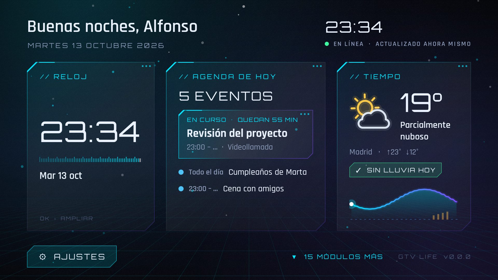

| Reloj digital | Reloj analógico (acento magenta) |
| --- | --- |
| 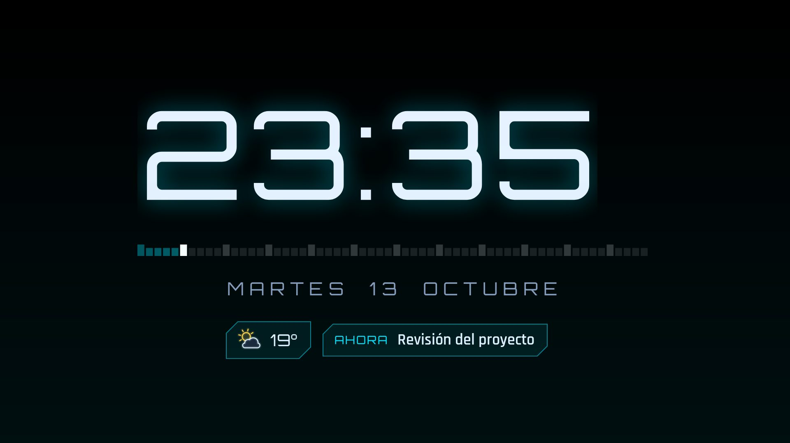 | 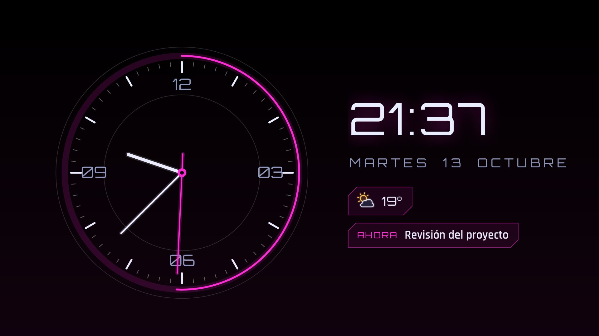 |
| **Calendario** | **Tiempo** |
| 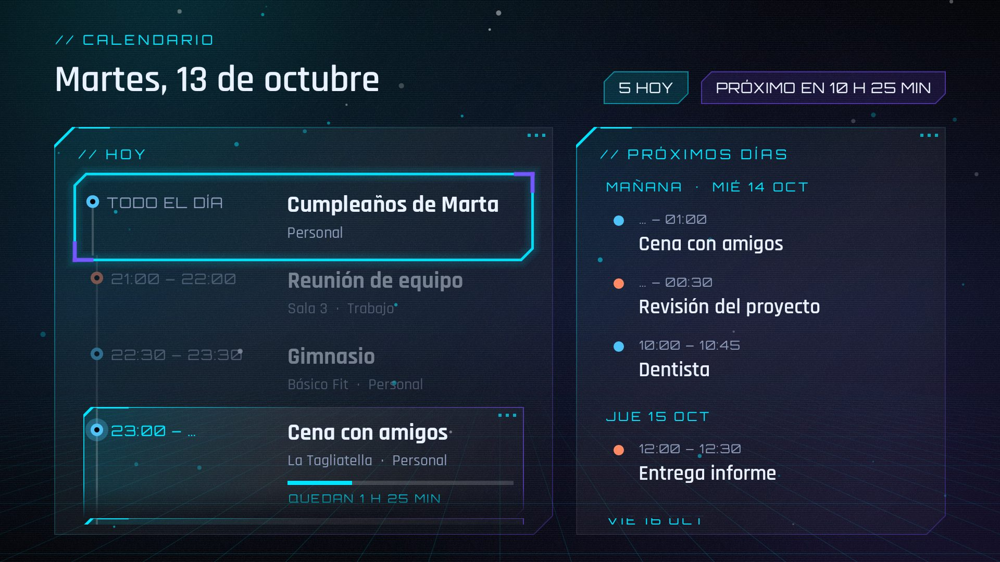 | 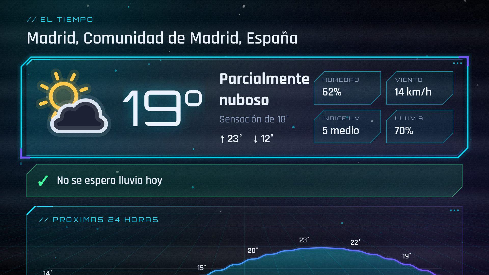 |
| **Configuración con QR** | **Web de configuración en el móvil** |
| 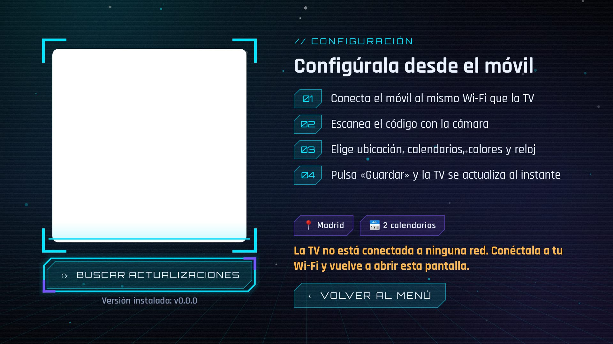 | 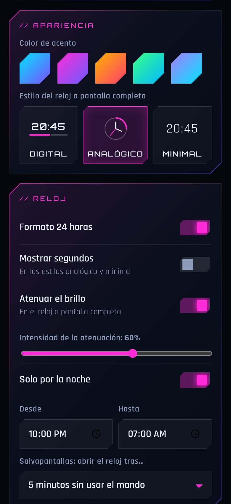 |

## Módulos

- **Reloj**: reloj grande a pantalla completa en tres estilos (**digital** con barra de segundos, **analógico** con segundero continuo, **minimal**). Si activas la opción, **atenúa el brillo** (siempre o solo en un horario nocturno). Con **OK** atenúas o restauras a mano. Se desplaza un poco cada minuto para no marcar la pantalla.
- **Calendario**: línea de tiempo de **hoy** (eventos pasados atenuados, evento en curso con barra de progreso y tiempo restante, marca de «ahora») y agenda de los **próximos 6 días**, desde las **direcciones secretas iCal** (Google Calendar, iCloud, Outlook…). Admite eventos recurrentes, excepciones y eventos de todo el día. Si falla la red, conserva los últimos datos buenos.
- **Tiempo**: el tiempo de hoy, **si va a llover y a qué horas**, gráfica de temperatura y lluvia de 24 h, arco del sol, índice UV y previsión de los dos próximos días (datos de [Open‑Meteo](https://open-meteo.com), sin API key).

## Módulos extra

Debajo de las tarjetas principales hay una cuadrícula de **15 módulos** que se activan y desactivan desde la configuración del móvil (y algunos se configuran ahí mismo). Cada uno tiene su tarjeta en el menú y una pantalla completa al pulsar OK.

| Módulo | Qué muestra | Fuente |
| --- | --- | --- |
| Previsión 7 días | Tiempo de la semana | Open‑Meteo |
| Calidad del aire | Índice europeo (EAQI), PM2,5, PM10, O₃, NO₂ | Open‑Meteo / CAMS |
| Polen | Niveles por tipo (solo Europa) | Open‑Meteo / CAMS |
| Fase lunar | Fase, iluminación, próximas lunas | Cálculo local |
| Relojes del mundo | Hora en las ciudades que elijas | Local |
| Cuenta atrás | Días que faltan (con repetición anual) | Local |
| Frase del día | Una cita distinta cada día | Local |
| Tal día como hoy | Efemérides | Wikipedia |
| Noticias | Titulares de tus feeds RSS | El País, RTVE, 20minutos… |
| Criptomonedas | Precio en € y gráfica de 7 días | CoinGecko |
| Divisas | Cambio del euro y gráfica de 30 días | BCE (Frankfurter) |
| Notas y tareas | Lista editable desde el móvil, se marcan con OK en la TV | Local |
| Temporizador | Temporizador y cronómetro con aviso sonoro en cualquier pantalla | Local |
| Precio de la luz | PVPC por horas, horas más baratas | Red Eléctrica |
| Calendario del mes | Vista mensual con tus eventos | Tus calendarios iCal |

| Módulos en el menú | Precio de la luz |
| --- | --- |
| 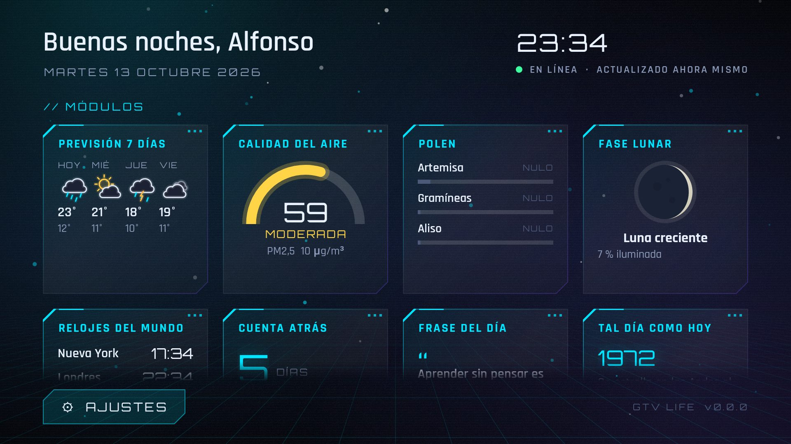 | 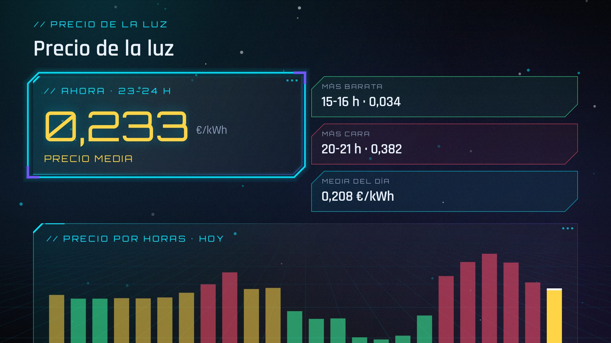 |
| **Previsión 7 días** | **Calendario del mes** |
| 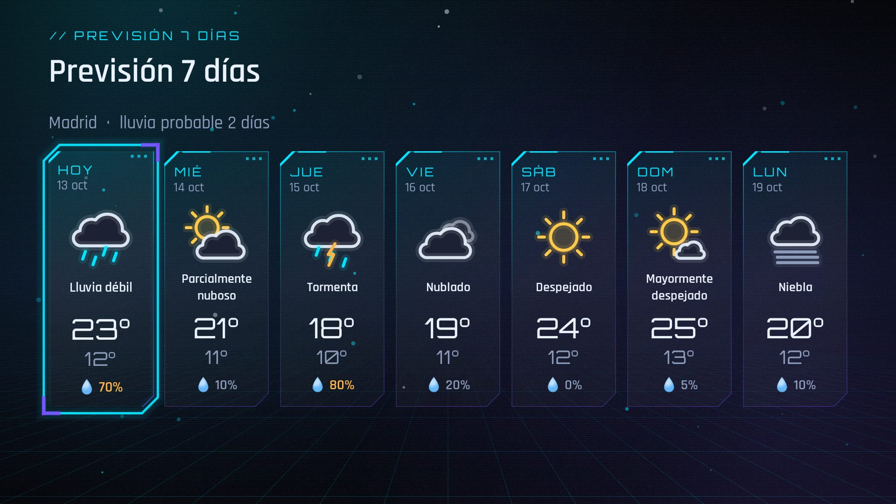 | 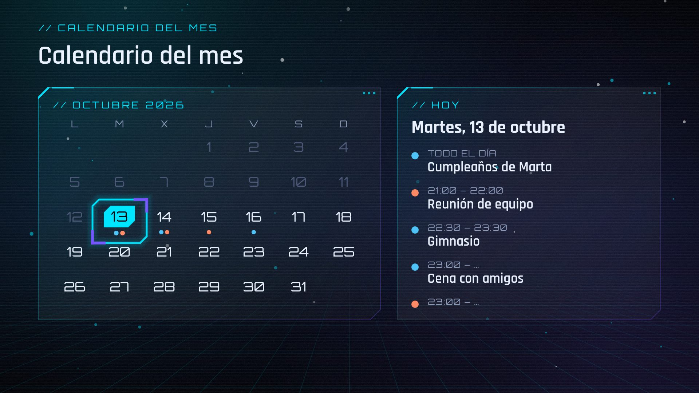 |

## Diseño

- Tipografías **Orbitron** y **Rajdhani** (licencia OFL, en `licenses/`).
- Fondo con texturas: auroras del color de acento, suelo de rejilla en perspectiva, grano, líneas de escaneo, viñeta y partículas flotando.
- Paneles de cristal con esquinas recortadas y bordes degradados.
- **Cursor luminoso** que se desliza hasta el elemento seleccionado y **desaparece tras 6 s sin tocar el mando**; la primera pulsación solo lo vuelve a mostrar.
- Iconos meteorológicos propios y animados, animación de arranque, entrada escalonada de las tarjetas y transiciones entre pantallas.
- Saludo personalizado, indicador de conexión y de última actualización, cinco colores de acento y salvapantallas que abre el reloj tras N minutos sin usar el mando.

## Configuración con el móvil (QR)

La primera vez que abres la app (o desde **⚙ Ajustes**) aparece un **código QR** en la TV:

1. Conecta el móvil a la **misma Wi‑Fi** que la TV.
2. Escanea el QR con la cámara: se abre una página web servida por la propia TV.
3. Escribe tu nombre, busca tu ciudad, pega las direcciones iCal (con **Probar** compruebas que funcionan), elige color, estilo de reloj, atenuación y salvapantallas.
4. Pulsa **Guardar**: la TV se actualiza sola.

Los datos (incluidas las direcciones secretas iCal) **solo se guardan en la TV**. El QR lleva un código aleatorio que cambia cada vez que abres la pantalla, así que nadie más de tu red puede cambiar la configuración sin ver la TV.

## Actualizaciones automáticas

Cada vez que se abre la app, consulta el **último lanzamiento** de este repositorio en GitHub. Si su versión es mayor que la instalada, descarga el APK adjunto y lo instala:

- La primera vez Android pedirá permiso para que GTV Life **instale aplicaciones desconocidas** (la app te lleva a ese ajuste) y una confirmación de instalación.
- A partir de ahí, en Android 12 o superior las actualizaciones pueden instalarse sin preguntar; en versiones anteriores solo hay que pulsar «Instalar».
- También puedes forzar la comprobación desde **⚙ Ajustes › Buscar actualizaciones** (botón debajo del QR).
- El repositorio tiene que ser **público** para que la TV pueda consultar los lanzamientos sin credenciales.

## Publicar una versión

1. En GitHub: **Releases › Draft a new release**.
2. Crea una etiqueta con el formato **`v1.2.3`** (la versión debe ser mayor que la anterior) y pulsa **Publish release**.
3. El workflow [`Release APK`](.github/workflows/release.yml) compila el APK firmado y lo adjunta al lanzamiento como `GTV-Life-v1.2.3.apk` (tarda unos minutos).

También puedes ir a **Actions › Release APK › Run workflow**, escribir la versión (p. ej. `1.2.3`) y el workflow compila el APK y crea el lanzamiento él solo.

### Firma de los APK (hacerlo una sola vez)

Android solo instala una actualización si está firmada con **la misma clave** que la versión instalada, así que el workflow necesita una clave fija guardada en los *secrets* del repositorio:

```bash
keytool -genkeypair -v -keystore gtv-life.jks -alias gtvlife \
  -keyalg RSA -keysize 4096 -validity 10000
base64 -w0 gtv-life.jks > gtv-life.jks.b64   # en macOS: base64 -i gtv-life.jks
```

En **Settings › Secrets and variables › Actions** crea:

| Secret | Valor |
| --- | --- |
| `ANDROID_KEYSTORE_BASE64` | contenido de `gtv-life.jks.b64` |
| `ANDROID_KEYSTORE_PASSWORD` | contraseña del keystore |
| `ANDROID_KEY_ALIAS` | `gtvlife` |
| `ANDROID_KEY_PASSWORD` | contraseña de la clave (la misma si no pusiste otra) |

Guarda `gtv-life.jks` en un lugar seguro: si la pierdes, habrá que desinstalar la app y volver a instalarla a mano.

## Primera instalación en la TV

La primera vez hay que instalar el APK a mano (después se actualiza sola):

- Con la app **Downloader** (o similar) en la TV, abre la URL del APK del último lanzamiento, o
- con ADB: `adb connect IP_DE_LA_TV && adb install GTV-Life-v1.0.0.apk`.

## Desarrollo

Proyecto Android nativo en Kotlin (minSdk 26, targetSdk 35).

```bash
./gradlew testDebugUnitTest assembleDebug
```

Capturas de todas las pantallas con datos de ejemplo (Robolectric, sin emulador):

```bash
./gradlew testDebugUnitTest -Pscreenshots=true                      # app/build/screenshots/
./gradlew testDebugUnitTest -Pscreenshots=true -PclockStyle=analog -Paccent=magenta
```

Las compilaciones locales tienen la versión `0.0.0` y no buscan actualizaciones. El repositorio que se consulta para las actualizaciones se toma de `GITHUB_REPOSITORY` en CI (o de `-PupdateRepo=owner/repo`).
